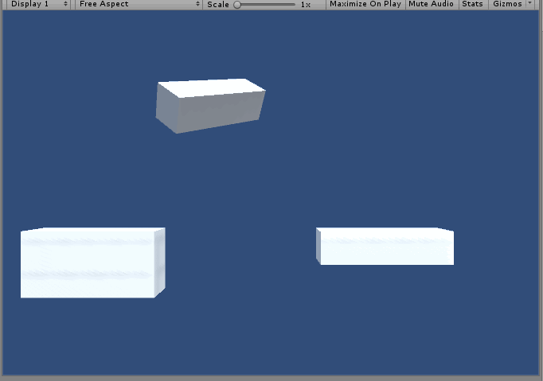
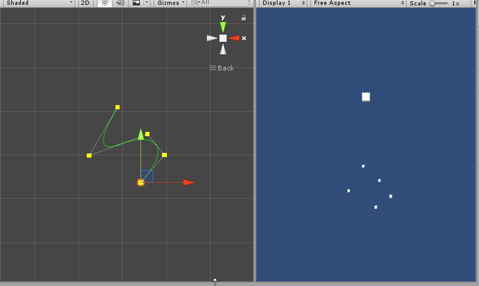
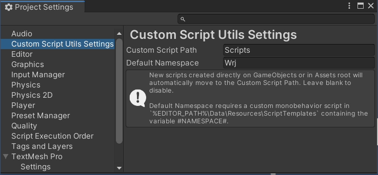
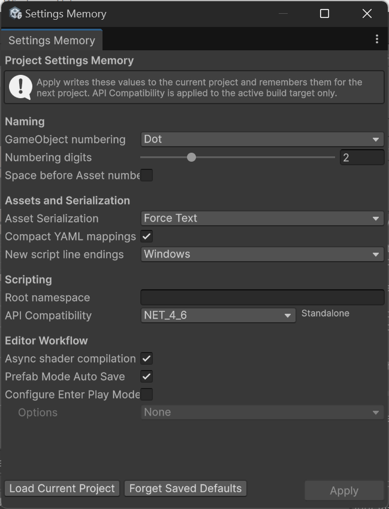

# Unity Scripting Utilities

A curated collection of reusable scripting utilities for Unity projects.

This package provides lightweight, production-tested helpers for: -
AnimationCurve-based tweening and easing - Transform and UI utilities -
Object and audio pooling - Weighted random selection - Bezier paths and
editor helpers - General-purpose gameplay utilities

Designed for rapid prototyping, interactive installations, tools, and
full-scale game systems.

------------------------------------------------------------------------

## Installation

### Via Unity Package Manager (Git URL)

In Unity: `Window → Package Manager → + → Add package from Git URL`

Use:

    https://github.com/williamrjackson/UnityScriptingUtilities.git

Optionally lock to a specific version:

    https://github.com/williamrjackson/UnityScriptingUtilities.git#v1.8.2
------------------------------------------------------------------------

## Screenshots & GIFs

The repository includes demonstration GIFs and screenshots. These are kept in
Documentation~ so they don’t bloat the UPM package.

Example embedded media (uses existing repository assets):

### Tweening Example



### Path Follower Example



### Presets Screenshot



------------------------------------------------------------------------

## Core Features

### Tweening & Easing (AnimationCurve-Based)

Extension methods for clean, readable motion code:

``` csharp
transform.Move(destination, duration);
transform.EaseRotate(targetRotation, duration);
transform.EaseScale(targetScale, duration);
```

Supported operations include: - Move / MoveWorld - Rotate - Scale -
MoveAlongPath - FadeAudio / CrossfadeAudio - FadeAlpha / ChangeColor -
SnapToSibling / EaseSnapToSibling

Curves can be mirrored, ping-ponged, or customized.

------------------------------------------------------------------------

### Weighted Random Selection

Select elements with weighted probabilities:

``` csharp
var weighted = new WeightedElements<string>();
weighted.Add("Common", 70);
weighted.Add("Rare", 25);
weighted.Add("Epic", 5);

string result = weighted.GetRandom();
```

------------------------------------------------------------------------

### Object Pooling

Efficient GameObject reuse to reduce instantiation overhead.

### Audio Pool

Play multiple overlapping sound effects without audio artifacts.

### Project Settings Memory

A Unity 6 editor-only package that remembers preferred project settings across
projects.

Open **Tools > Project Settings Memory...**. The first time the tool is used on
a machine it initializes from the current project, which means a fresh project
uses the actual defaults for its Unity version and template. Clicking **Apply**:

1. writes the displayed values into the current project's settings;
2. stores the same preset in Unity's per-user `EditorPrefs`;
3. uses that preset when the window is opened in another project.

**Load Current Project** replaces the form with the current project's values.
**Forget Saved Defaults** deletes the cross-project preset; it does not revert
the current project.

API Compatibility applies to the active build target shown beside the field.
Switch build target before applying if you need to configure another target.



### Notes

- Remembered defaults are local to the current OS user and Unity editor
  installation preferences; they are not committed with a project.
- Applied project settings are stored by Unity in `ProjectSettings` and should
  be committed as usual.
- Skipping Domain Reload can substantially speed up Play Mode, but requires
  code that resets static state and event subscriptions correctly.

------------------------------------------------------------------------

## Utility Helpers

Includes helpers such as:

-   EnsureComponent`<T>`()
-   DeferredExecution
-   Switcheroo`<T>`()
-   AffectGORecursively
-   Random element selection helpers
-   Coin flip helpers
-   Bezier utilities
-   Unit converters (FromFeet, FromInches)
-   Screen size notifications
-   Custom logging tools

------------------------------------------------------------------------

## Project Structure

    Audio/
    Editor/
    LayoutGroups/
    Paths/
    WrjUtils.cs
    PoolManager.cs
    ScreenSizeNotifier.cs
    ...

------------------------------------------------------------------------

## Compatibility

-   Unity 2022.3+
-   Unity Input System 1.7.0 (installed automatically through Package Manager)

------------------------------------------------------------------------

## Contributing

Issues and pull requests are welcome.

------------------------------------------------------------------------

## License

MIT License

## Keybindings input backends

`Wrj.Keybindings` supports Input Manager (Old), Input System Package (New),
and Both under **Player > Other Settings > Active Input Handling**. Both uses
only the new backend, so commands fire once. The package depends on Input System
1.7.0 or later; Unity Package Manager installs it automatically.

Existing Inspector bindings and the `KeyCode` API remain unchanged. Key down,
key up, modifiers, Escape to quit, and F11 fullscreen use the selected backend.
The new backend supports keyboard keys and Mouse0-Mouse4 and safely ignores
missing devices.

### Keyboard layouts

Set **Keyboard Mapping** on the Keybindings component:

- **Current Layout** (default): letters, digits, and punctuation follow the
  active OS keyboard layout. A binding to `KeyCode.W` responds to the key labeled
  W in Windows' active layout, including Dvorak, rather than the US W position.
- **Physical Position**: bindings use physical US keyboard positions regardless
  of the active layout. Use this for controls that should stay in the same place.

Existing serialized `KeyCode` bindings do not need conversion. The default also
applies to existing components that do not yet have a saved Keyboard Mapping
value. Select Physical Position to retain the previous new-backend behavior.
Layout changes while running are picked up on the next input query; no restart
is required. Escape, function keys, arrows, modifiers, Space, and keypad keys
keep their physical mappings in either mode. Ctrl/Shift/Alt/Win requirements
continue to work with layout-aware bindings.

Layout lookup uses the key's label, not composed text. A label unavailable on
the current layout does not trigger a command; there is no physical fallback.
Use text-input events for typing, shifted characters, dead keys, or IME input.
Keyboard Mapping applies to the new backend (New or Both); Old uses the legacy
Input Manager's own mapping settings.

Legacy joystick KeyCodes and Mouse5/Mouse6 are unsupported by the new backend;
use Input Actions for controller bindings. Physical Position also ignores
character codes without a mapped physical key equivalent.
